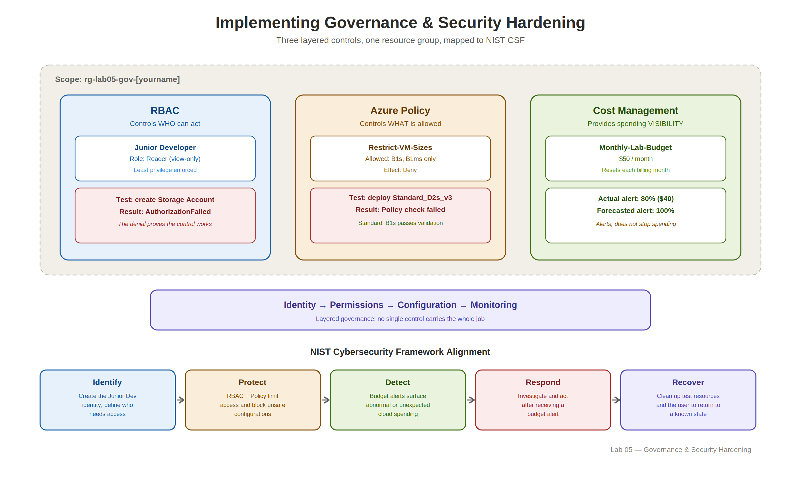

# Lab 05 — Implementing Governance and Security Hardening

Implementing Azure governance and security controls with Role-Based Access Control (RBAC), Azure Policy, Cost Management budgets, and the NIST Cybersecurity Framework (CSF).


## 🎥 Watch Me Live

[Watch me build this lab live →](https://www.loom.com/share/be3148659a964853af3563bc76e60e18)

## Overview

| | |
|---|---|
| **Time to complete** | 60–75 minutes |
| **Difficulty** | Beginner |
| **Tools used** | Microsoft Entra ID, Azure RBAC, Azure Policy, Cost Management, Azure Portal |
| **Framework** | NIST Cybersecurity Framework (CSF) |
| **Career relevance** | Cloud Governance, Azure Security, IAM, Compliance, Cost Management |

## The Concept This Lab Introduces

Cloud governance is the set of rules, roles, and guardrails that control **who can do what, what configurations can be deployed, and how cloud spending is monitored**.

This lab puts those concepts into practice by building three complementary controls:

- **RBAC** controls who can act.
- **Azure Policy** controls what configurations are allowed.
- **Cost Management** provides visibility and alerts when spending approaches a defined threshold.

The lab maps these controls to the **NIST Cybersecurity Framework** functions:

**Identify → Protect → Detect → Respond → Recover**

By the end of the lab, a Junior Developer has view-only access, expensive VM configurations are blocked by policy, and a budget is configured to alert before cloud spending gets out of control.



## Lab Variables

| Resource / Variable | Value |
|---|---|
| **Resource Group** | `rg-lab05-gov-[yourname]` |
| **Test User UPN** | `junior-dev-[yourname]@[yourtenant].onmicrosoft.com` |
| **Test User Display Name** | `Junior Developer` |
| **Policy Assignment** | `Restrict-VM-Sizes` |
| **Allowed VM Sizes** | `Standard_B1s`, `Standard_B1ms` |
| **Budget Name** | `Monthly-Lab-Budget` |
| **Budget Amount** | `$50` |
| **Actual Alert** | `80%` |
| **Forecasted Alert** | `100%` |
| **Region** | East US |

## What I Built

- Created a dedicated governance resource group: `rg-lab05-gov-[yourname]`.
- Created a test **Junior Developer** user in Microsoft Entra ID.
- Assigned the **Reader** role at the resource-group scope.
- Verified that the Junior Developer could view resources but could not create them.
- Created an Azure Policy assignment named `Restrict-VM-Sizes`.
- Restricted VM deployments to `Standard_B1s` and `Standard_B1ms`.
- Tested the policy by attempting to deploy a prohibited `Standard_D2s_v3` VM.
- Created a `$50` monthly budget using Azure Cost Management.
- Configured an **80% Actual** spending alert.
- Configured a **100% Forecasted** spending alert.
- Connected the lab controls to the NIST Cybersecurity Framework.

## Skills Demonstrated

| Skill | Real-world application |
|---|---|
| **Azure RBAC** | Controlling what users can access and do |
| **Least Privilege** | Giving users only the permissions required for their role |
| **Microsoft Entra ID** | Creating and managing cloud identities |
| **Azure Policy** | Enforcing approved resource configurations |
| **Cloud Governance** | Applying rules and guardrails to cloud environments |
| **Cost Management** | Monitoring cloud spending and setting budget alerts |
| **NIST CSF** | Mapping cloud security controls to Identify, Protect, Detect, Respond, and Recover |
| **Security Validation** | Deliberately testing controls to verify they work |

## Step-by-Step Setup

### Phase 1 — Create the Lab Resource Group

Create the resource group that will contain the governance exercise:

```text
Resource Group: rg-lab05-gov-[yourname]
Region: East US
```

This resource group becomes the controlled scope for the RBAC assignment, Azure Policy, and budget.

---

### Phase 2 — RBAC: Create a User and Restrict Access

Create a test user in Microsoft Entra ID:

```text
Username: junior-dev-[yourname]
Display name: Junior Developer
```

Set a password that you can use during the access verification test.

Then assign the **Reader** role to the user at the resource-group scope:

```text
Scope: rg-lab05-gov-[yourname]
Role: Reader
Member: Junior Developer
```

The Reader role allows the user to view resources but prevents them from creating, modifying, or deleting resources.

This demonstrates the principle of **least privilege**.

---

### Phase 3 — Verify Access: Permission Denied Test

Open an Incognito or Private browser window and sign in as:

```text
junior-dev-[yourname]@[yourdomain].onmicrosoft.com
```

Verify that the Junior Developer can see:

```text
rg-lab05-gov-[yourname]
```

Then attempt to create a Storage Account.

Expected result:

```text
AuthorizationFailed
```

or another permission-denied validation message.

The failure is intentional—the Reader role is working as designed.

---

### Phase 4 — Azure Policy: Prevent Expensive Configurations

Create an Azure Policy assignment using the built-in policy definition:

```text
Allowed virtual machine size SKUs
```

Configure:

```text
Scope: rg-lab05-gov-[yourname]
Assignment name: Restrict-VM-Sizes
```

Allowed VM sizes:

```text
Standard_B1s
Standard_B1ms
```

The policy uses a **Deny** effect, meaning deployments that use an unapproved VM size are blocked.

> **Important:** Azure Policy can take approximately 10–30 minutes to fully propagate after assignment.

---

### Phase 5 — Test the Policy

Attempt to create a VM inside:

```text
rg-lab05-gov-[yourname]
```

Use:

```text
Image: Ubuntu Server
Size: Standard_D2s_v3
```

Expected result:

```text
Validation failed
Policy check failed: Restrict-VM-Sizes
```

The `Standard_D2s_v3` size is intentionally not included in the allowed list.

Then select:

```text
Standard_B1s
```

The validation should pass because it is an approved VM size.

You do not need to complete the VM deployment. The validation results demonstrate that the policy works in both directions.

---

### Phase 6 — Cost Management: Set Up a Budget and Alerts

Create a budget for:

```text
Name: Monthly-Lab-Budget
Reset period: Billing month
Budget amount: $50
Expiration: One year from today
```

Configure two alert conditions.

#### Early Warning

```text
Alert type: Actual
Threshold: 80%
```

This sends an alert when actual spending reaches $40 of the $50 budget.

#### Forecasted Warning

```text
Alert type: Forecasted
Threshold: 100%
```

This sends an alert when Azure projects that spending will exceed the $50 budget before the end of the billing period.

Add your personal email as the alert recipient.

> **Important:** An Azure budget does **not** stop spending, delete resources, or prevent new deployments. It is a monitoring and alerting control.

## How the Controls Work Together

| Scenario | Control | Result |
|---|---|---|
| Junior Developer tries to delete a resource | **RBAC** | Reader permissions prevent the action |
| Engineer tries to deploy an unapproved VM size | **Azure Policy** | Deny policy blocks the deployment |
| Cloud spending unexpectedly increases | **Budget Alert** | Email notification signals that investigation is needed |
| Developer account is compromised and attempts expensive VM deployments | **Policy + Budget** | Policy blocks unapproved sizes while the budget provides spending visibility |

Together, these controls create layered governance:

**Identity → Permissions → Configuration → Monitoring**

## NIST Cybersecurity Framework Alignment

| NIST Function | How this lab demonstrates it |
|---|---|
| **Identify** | Create the Junior Developer identity and understand who requires access |
| **Protect** | Use RBAC and Azure Policy to limit access and prevent unsafe configurations |
| **Detect** | Use budget alerts to identify abnormal or unexpected cloud spending |
| **Respond** | Investigate and act after receiving a budget alert |
| **Recover** | Clean up the test resources and user to return the environment to a known state |

## Verification Checklist

- [ ] Junior Developer user exists in Microsoft Entra ID.
- [ ] Reader role is assigned at the `rg-lab05-gov-[yourname]` scope.
- [ ] Junior Developer receives a permission-denied result when attempting to create a resource.
- [ ] `Restrict-VM-Sizes` policy is assigned to the lab resource group.
- [ ] `Standard_D2s_v3` is blocked by the policy.
- [ ] `Standard_B1s` passes policy validation.
- [ ] `Monthly-Lab-Budget` exists with a `$50` limit.
- [ ] 80% Actual alert is configured.
- [ ] 100% Forecasted alert is configured.
- [ ] Email recipient is configured.

## Troubleshooting

| Problem | Solution |
|---|---|
| **Junior Developer can still create resources** | Verify the Reader role is assigned at `rg-lab05-gov-[yourname]`, not at an unintended scope. |
| **Policy is not blocking the VM** | Wait 10–30 minutes for policy propagation and verify `Restrict-VM-Sizes` is scoped to the lab resource group. |
| **Cannot find Budgets** | Open **Cost Management + Billing** from the main Azure search and navigate to Budgets. |
| **Incognito login requests MFA** | Complete the Microsoft Entra MFA setup. This is normal for a first login. |
| **Allowed VM size policy cannot be found** | Search for `virtual machine size` and select the policy definition that restricts allowed VM sizes. |
| **Budget creation fails with a permissions error** | Verify the account has the required Cost Management permissions, such as Cost Management Contributor or Owner. |

## Clean Up

Always clean up the lab after completion.

### Delete the Resource Group

Delete:

```text
rg-lab05-gov-[yourname]
```

This removes the resources and governance controls scoped to the lab resource group.

### Delete the Test User

In Microsoft Entra ID, delete:

```text
junior-dev-[yourname]
```

### Verify Cleanup

Confirm that:

- `rg-lab05-gov-[yourname]` is no longer listed under Resource Groups.
- `junior-dev-[yourname]` is no longer listed under Microsoft Entra ID → Users.

Cleaning up returns the environment to a known state and prevents unused identities and resources from remaining in the environment.

## Interview Talking Points

### What is RBAC and why does it matter?

RBAC stands for **Role-Based Access Control**. It enforces least privilege by assigning users the minimum permissions required to perform their work.

### What is the difference between Azure RBAC and Azure Policy?

**RBAC controls who can act. Azure Policy controls what configurations are allowed.**

A user may have permission to deploy resources while a policy can still prevent them from deploying an unapproved configuration.

### What is the NIST Cybersecurity Framework?

NIST CSF organizes cybersecurity activities around five functions:

```text
Identify
Protect
Detect
Respond
Recover
```

This lab demonstrates the first four directly and uses cleanup as an example of Recover thinking.

### Does an Azure budget stop spending?

No. An Azure budget is a **monitoring and alerting tool**. It does not automatically stop resources, delete resources, or prevent new deployments.

## Related Labs

- **Lab 02** — Building a Secure 2-Tier Web Application
- **Lab 03** — Modernizing to PaaS & Securing Secrets
